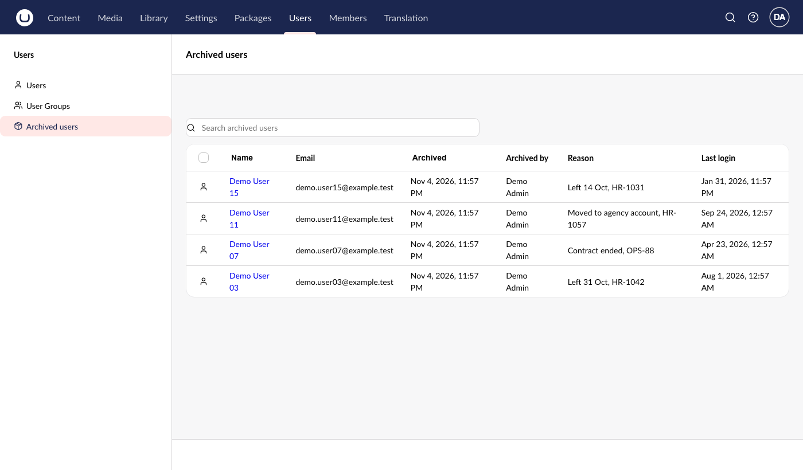

# Archived Users for Umbraco

[](https://www.nuget.org/packages/Umbraco.Community.ArchivedUsers)
[](https://www.nuget.org/packages/Umbraco.Community.ArchivedUsers)
[](https://github.com/PascalA94/Umbraco.Community.ArchivedUsers/blob/main/LICENSE)

A community package, not made or supported by Umbraco HQ. Requires Umbraco 18.3+ (package 18.x) or Umbraco 17.8+ (package 17.x), on .NET 10.

Adds an **Archived** area to the Umbraco Users section. Archive leavers so they drop out of the Users list and user pickers, while their history stays intact and every archive is recorded: who, whom, when and why.

Umbraco won't delete a user who has ever logged in, so long-lived sites fill up with disabled ex-staff and ex-agency accounts. This package hides them without deleting anything.

> **Status: prerelease (v0.1, "Archive by hand").** The API, settings and aliases may still change before 1.0.



## What "archived" means

- Archiving always **disables** the user (through Umbraco's own `IUserService`) and ends their sessions. An archived user can't log in.
- It never deletes the user, their group memberships or anything they created.
- It stores a small record: when, by whom, the reason, and whether the user was already disabled.
- **Unarchive** removes the record. The user comes back **disabled**. Enable them with Umbraco's own Enable action when they need access again (or see `UnarchiveEnablesUser`).
- If someone enables an archived user through Umbraco itself, the archive record is removed automatically and the change is audited.

## Install

```bash
dotnet add package Umbraco.Community.ArchivedUsers --prerelease
```

Run the site. The package creates its two tables on start-up (`archivedUsersUser`, `archivedUsersAudit`).

## Using it

- **Archive one user:** open the user, choose **Archive** from the actions menu, add a reason (optional unless the site requires one) and confirm.
- **Archive several users:** select them in the Users list and choose **Archive** in the selection bar. You get "N archived, M skipped" with a reason for each skip (yourself, invited users, users you may not manage, and so on).
- **Archive every disabled user:** the **Archive disabled users** button next to Create shows how many will be archived and up to ten names before you confirm.
- **Archived users** (under Users in the section menu): search by name or email, sort by name or archived date, open a user, or select rows and **Unarchive**.
- If a disabled user has never logged in, the Archive dialog reminds you that Umbraco's own **Delete** works for them.

Who can do what: anyone with access to the Users section can archive and unarchive **non-admin** users. Only admins can archive admins. Nobody can archive themselves, an invited user or the superuser. The package checks this on the server for every user, whatever the UI shows.

## Configuration

`appsettings.json`:

```json
"ArchivedUsers": {
  "HideArchivedFromUserList": true,
  "HideArchivedForApiUsers": false,
  "RequireReason": false,
  "UnarchiveEnablesUser": false
}
```

| Key | Default | What it does |
|---|---|---|
| `HideArchivedFromUserList` | `true` | Hides archived users from the Users list and user pickers. `false` gives exactly Umbraco's own behaviour. |
| `HideArchivedForApiUsers` | `false` | API users (client credentials) get Umbraco's unfiltered `filter/user` list unless this is `true`, so integrations don't silently lose users. |
| `RequireReason` | `false` | Archive and **Archive disabled users** need a reason. Checked on the server too. |
| `UnarchiveEnablesUser` | `false` | Unarchive also re-enables users who were **enabled** before they were archived. Users who were already disabled stay disabled. |

**Load-balanced sites:** use identical settings on every server, `RequireReason` above all.

## Side effects of hiding (please read)

Archived users are hidden from every screen that lists users through Umbraco's `GET /umbraco/management/api/v1/filter/user`:

| Screen | Archived users shown? |
|---|---|
| Users list (grid and table, with search and filters) | No |
| User group: member list | No. They are still members, just not listed |
| User group: "Choose" users picker | No |
| User Picker property editor in Content | No |
| User editor, `item/user` references (for example "created by" on content), current user | Yes, never filtered |

- Only users who are archived **and** disabled are hidden. If an archived user is enabled again outside the package (SQL, uSync), they are always shown, flagged "Enabled - archive record is stale" in Archived users, and the record is tidied up at the next start-up.
- Integrations that call `filter/user` as a backoffice user also stop seeing archived users. API users (client credentials) still see them unless `HideArchivedForApiUsers` is on.
- Umbraco's own `Umbraco:CMS:Security:HideDisabledUsersInBackOffice` hides **all** disabled users, archived or not. The two work together; **Archive disabled users** still counts disabled users on the server.
- On very large sites (more than 20,000 users visible to the viewer) the list falls back to Umbraco's own response rather than load everyone.
- An archive record whose user was deleted outside Umbraco (for example by SQL) can't be unarchived through the API; it is skipped in the list and removed at the next start-up.

## Security notes

- **Hiding is not access control.** Archiving disables the user; hiding is a convenience. If the package's hiding fails for any reason, Umbraco's own list is returned.
- Archiving ends the user's sessions: Umbraco revokes their tokens on disable, refuses disabled users at sign-in (Umbraco 17.8.0 / 18.3.0 and later), and the package also rotates the security stamp. Access tokens are validated against the token store, so an archived user's last access token stops working at once.
- An archived (disabled) user can't archive anyone, even with a token that is somehow still live. Two admins archiving each other at the same instant could still both end up disabled. The superuser can never be archived by the package, so **keep the superuser enabled as your recovery account.**
- Umbraco does not revoke the superuser's tokens on disable; the package never targets the superuser.
- Don't relax `Umbraco:CMS:Security:BackOfficeTokenCookie:SameSite`; the backoffice's CSRF protection relies on it.
- Report vulnerabilities privately: see [SECURITY.md](SECURITY.md).

## Personal data (GDPR)

The site owner is the data controller. The package stores:

- **`archivedUsersUser`:** user key, archive time, archiving user's key, source, reason, whether the user was already disabled.
- **`archivedUsersAudit`:** one row per archive or unarchive: user key, action, performing user's key, time, source, reason, a **snapshot of the user's name** (never the email), and whether the user was re-enabled.
- It also writes one entry to Umbraco's own audit log (action and source only) for each archive or unarchive made through the package. Records removed automatically (a user enabled through Umbraco itself, or tidied up at start-up) get a row in `archivedUsersAudit` only.

Lawful basis: legitimate interest in keeping evidence of who had access and who removed it. Audit rows have no foreign key to Umbraco's user table, so they **outlive deleted users by design**. The reason field is free text: **don't put sensitive personal details in it; use a ticket reference.**

Retention and erasure controls (an `Audit:RetentionDays` purge and per-user name erasure) arrive in v0.2. Please don't purge the tables by hand.

## Uninstall

Remove the package. Its tables stay in the database; drop `archivedUsersUser` and `archivedUsersAudit` yourself if you no longer need the history. Archived users stay disabled.

## Supported versions

| Package | Umbraco | Branch |
|---|---|---|
| 18.x | 18.3.0 to 18.x (`[18.3.0, 19.0.0)`) | `main` |
| 17.x | 17.8.0 to 17.x (`[17.8.0, 18.0.0)`) | `v17` |

On Umbraco 17, install a 17.x version: `dotnet add package Umbraco.Community.ArchivedUsers --version 17.0.0-alpha.1`. A bare `--prerelease` install picks the newest 18.x, which needs Umbraco 18.

17.8.0 and 18.3.0 are the first releases where Umbraco refuses disabled users at sign-in, and they include the 27 October 2026 security fixes.

## Contributing

See `docs/design.md` and `docs/plan.md`. Spike results are in `docs/spikes.md`. Issues and pull requests are welcome.

## Licence

MIT. See [LICENSE](LICENSE).
