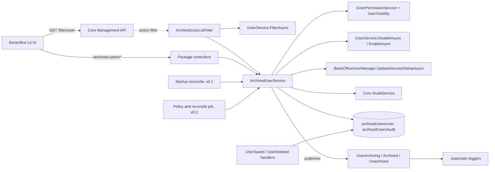

# 01 Archived Users: design doc

| | |
|---|---|
| Packages | `Umbraco.Community.ArchivedUsers` and `Umbraco.Community.ArchivedUsers.Automate` |
| Targets | Umbraco 17 and 18, as two release lines |
| Owner | Pascal Meyer |
| Licence | MIT |
| Status | Design, revised after the security review. Nothing built |
| Written | 2026-10-29. Revised 2026-10-30 (see "Security review changes" at the end) |
| Sources | the private scope notes (their Decisions section wins), the private portfolio README, an Umbraco pitfalls reference, the private security review `security-review.md` (findings AU-01 to AU-16, facts V1 to V18) |

How to read the tags:
- **[verified]**: read in Umbraco-CMS source or on NuGet on 2026-10-29 (`main` at `f7f06d9`, plus `release/17.9.0` and `release/18.4.0`). Those two are **unreleased** branches (security review V18). The latest released tags on 2026-10-30 are `release-17.8.0` and `release-18.3.0`, which are now the floors.
- **[verified, review Vn]**: verified by `security-analyst` on 2026-10-30, fact Vn in `security-review.md` section 2.
- **[unverified]**: inferred. A spike in section 8 proves or kills it.
- **(architect's call)**: not decided by Pascal. Decided here so the builder doesn't have to guess. Change it if a spike says so.
- **D1 to D8**: Pascal's decisions, listed in section 5.

Umbraco moves fast. Re-check the [verified] facts against the latest 17.x and 18.x before M0.

---

## 1. Intent and why

**Intent:** give the Users section an **Archived** area, so leavers stop cluttering the Users list while their history stays intact.

**Why it's needed:**
- Core won't delete a user who has ever logged in. [verified]
  - `UserService.DeleteAsync` returns `CannotDeleteUserWithLoginHistory` when `LastLoginDate` is set.
  - The reason in the code: such users may have audit trails and versions tied to their Id.
  - Same check on 17.9 and 18.4.
  - Source: [UserService.cs](https://github.com/umbraco/Umbraco-CMS/blob/main/src/Umbraco.Core/Services/UserService.cs) (`DeleteAsync`, about line 1559).
- So on any long-lived site the Users list fills with disabled ex-staff and ex-agency accounts.
- Nobody else does this on v17+. [verified, NuGet and Marketplace, 2026-10-29]
  - The nearest packages are v8-era (`azdyrski.Umbraco-User-Reporting`) or do something else (uSync.PeopleEdition, AdvancedPermissions, User2FA, AzureSSO, Impersonator).
- Demand exists:
  - [Discussion #21633](https://github.com/umbraco/Umbraco-CMS/discussions/21633): disable users after inactivity.
  - [Discussion #22548](https://github.com/umbraco/Umbraco-CMS/discussions/22548): who disabled whom.
- It fits the portfolio's governance theme (packages 01, 02, 09, 10).

**Archive is a soft state on top of Disabled.** It is a package-owned flag. It never deletes a user.

---

## 2. Goals, non-goals and anti-goals

### Goals
- Leavers vanish from the Users list and user pickers, with correct totals and paging.
- One click archives every disabled user on an old site.
- Every archive and unarchive is audited: who, whom, when, why, how.
- Access reviews (ISO 27001, Cyber Essentials) can be answered from the backoffice, with a CSV (v0.2).
- Optional hands-off hygiene: disable, then archive, after N days without a login (v0.2).
- Automate triggers and actions, in a separate sub-package (v0.2).
- Works on 17 and 18, SQLite and SQL Server, single server and load-balanced.

### Non-goals
- Deleting users. Core Delete already works for never-logged-in users (D6).
- Anonymising ex-staff names or emails. Later, if ever.
- An "Archived" option in the core Status filter. The header has no extension point. [verified]
- Changing group memberships on archive (D8).
- Member (front-end) accounts. Users only.
- Umbraco 13 or older.

### Anti-goals (failure even if it "works")
- **An archived user can log in.** Archived must always mean Disabled (D2).
- **The package widens access.** A non-admin sees or changes an admin through any package route. Security Critical, never waivable.
- **The package writes to `umbracoUser` directly.** All state changes go through `IUserService`.
- **Archiving loses history.** Any foreign key, cascade or delete that removes audit rows or core audit links.
- **The Users section breaks or changes shape.** Core bulk actions, grid and table views, Create, filters or pickers stop working because we replaced them.
- **A site that turns the package's hide switch off sees anything different from core.**
- **Sites without Automate pull in Automate** (D5).
- **Renamed IDs or aliases after release.** NuGet IDs, manifest aliases, table names and Automate aliases are permanent (README rule).

---

## 3. Users and core use cases

**Who uses it:**
- **Agency admin** (main user). Manages users across many client sites.
- **Client IT lead.** Asks access-review questions. Rarely logs in.
- **Non-admin with Users section access.** Can archive non-admins only, same as core Disable.

**Core use cases:**
1. **Offboard a leaver.** Sam opens Jo's user, clicks **Archive**, types "Left 24 Oct, SUP-123". Jo is disabled and leaves the Users list. Jo shows in **Archived users** with who, when and why.
2. **One-off clean-up.** A v13-to-v17 site has 140 users, 90 disabled. Admin clicks **Archive disabled users**, sees "90 will be archived", confirms. The list drops to 50.
3. **Access review.** IT lead asks who has access, who hasn't logged in for 90 days, and who removed access when. Admin uses Archived users and the audit, and exports CSV (v0.2).
4. **Returning contractor.** Admin unarchives them. They come back **Disabled** (D3). Admin enables them on day one.
5. **Hands-off hygiene (v0.2).** appsettings policy: disable at 90 days, archive at 180. Runs nightly, dry run first. Everything audited.

---

## 4. Constraints

### Versions
- Umbraco 17 (LTS) and 18. Two release lines, not multi-targeted. [verified reasons]
  - Both majors target `net10.0`, so TFM multi-targeting can't split them.
  - `/filter/user` action: `Filter` on v17, `Filter2` (adds `userKinds`) on v18. `Filter` is `[NonAction]` on v18, due for removal in v20.
  - OpenAPI: Swashbuckle on v17, `Microsoft.AspNetCore.OpenApi` on v18.
  - `@umbraco-cms/backoffice` typings differ (17.x vs 18.x).
  - Migrations: only `AsyncMigrationBase` exists on v18. v17 has both. Use `AsyncMigrationBase` on both.
- This is one of only two portfolio packages allowed two lines (README "one build where possible" rule).
- Automate: `Umbraco.Automate.Core [17.0.0,18.0.0)` and `[18.0.0,19.0.0)`. [verified]
- Databases: SQLite and SQL Server.
- Hosting: single server and load-balanced.

### Licence
- MIT, both packages.

### Security (from `umbraco-pitfalls.md`; Critical and Security items are mandatory)
- **S1 Backoffice authorisation [Critical]:**
  - Every controller inherits `ManagementApiControllerBase`.
  - `[VersionedApiBackOfficeRoute("archived-users")]`.
  - `[Authorize(Policy = AuthorizationPolicies.SectionAccessUsers)]` on every controller.
  - Own `[ApiExplorerSettings(GroupName = "Archived Users")]`.
  - Never `UmbracoApiController`, plain `ControllerBase` or `[AllowAnonymous]`.
- **P2 No statics holding scoped things [Critical]:** repositories, services and the action filter are DI-registered. No static `IScope`, `HttpContext` or user.
- **S3 XSS [Critical]:** `reason` and names are user text. Render with Lit's default escaping. Never `unsafeHTML`. Trim and cap `reason` at 500 chars on the server.
  - User data (names, emails, reasons, sample lists) is **never** placed inside a string passed to `UMB_CONFIRM_MODAL` `content`/`headline`, `localize.htmlString`, `localize.term` used as HTML, or notification `peek` HTML. Core renders those with `unsafeHTML` and escapes only the args [verified, review V15, V16]. Pass user data as a Lit `TemplateResult` with text bindings, or as localisation **args** to `localize.term` / `<umb-localize .args=${[name]}>` rendered as text. (AU-04)
  - The package never uses `UMB_CONFIRM_MODAL` or `localize.htmlString` (banned outright, plan review P11). Both confirm dialogs use the package's own modal; sample names render with `repeat` and text bindings. (AU-04)
  - The first argument of `localize.term` is always a string literal (a key), never a variable or template literal (plan review P11).
  - CI fails the build on any of these in the client source: `unsafeHTML`, `unsafeSVG`, `unsafeStatic`, `innerHTML`, `outerHTML`, `insertAdjacentHTML`, `DOMParser`, `createContextualFragment`, `document.write`, `setHTMLUnsafe`, `srcdoc`, `eval(`, `new Function(`, `UMB_CONFIRM_MODAL`, `htmlString`, or a non-literal first argument to `.term(` (AU-04, plan review P11).
- **No privilege widening (AU-01):**
  - **`IUserService` does not authorise. The package authorises every write itself.** `DisableAsync` checks only performer exists, not self, keys found, not invited; `EnableAsync` checks nothing. Core's "only admins touch admins" rule lives in core's controllers (`AuthorizationPolicies.UserPermissionByResource`), not in the service [verified, review V1 to V4].
  - Every write (archive, unarchive, enable on unarchive, clean-up, and the v0.2 Automate actions) passes, per target user, **both** core's own rule `IUserPermissionService.AuthorizeAccessAsync(performer, { key })` (the same call the `UserPermissionByResource` policy resolves to) **and** `UserVisibility.CanSee` (adds the superuser rule core's policy lacks). Failure is `NotPermitted`. The check lives inside `ArchivedUserService`, the single choke point for controllers, job and Automate, not only in controllers.
  - The superuser (`Constants.Security.SuperUserKey`) is never a valid archive, unarchive or disable target on any path, including the v0.2 job and Automate.
  - The v0.2 job's bypass is an `internal` method on the concrete service, not on `IArchivedUserService`, so no other caller (including the `.Automate` assembly) can reach it by accident.
  - Writes to user state go only through `IUserService.DisableAsync` / `EnableAsync` and core identity (`IBackOfficeUserManager`, for the security stamp, AU-02). Never SQL.
  - Reads returning users: only via `IUserService.FilterAsync` (core visibility rules), or an explicit check that the performer can see that user.
  - Per-user status never reveals whether a key belongs to an admin: for a non-admin performer, unknown keys and non-visible keys both return `NotPermitted` (AU-16).
  - The performer must exist and not be `Disabled`. A disabled (for example just-archived) performer gets `NotPermitted` for every key, and core is never called. This stops an archived admin whose access token is still live (U1) from archiving others, and makes two admins archiving each other one after the other leave one enabled (plan review P9). The truly simultaneous case is a residual risk (section 11).
- **Ending sessions on archive (AU-02):** after a successful `DisableAsync`, rotate the user's security stamp through `IBackOfficeUserManager.UpdateSecurityStampAsync`. Core revokes tokens on disable (review V7), and from the 17.8.0 / 18.3.0 floors the authorize flow refuses disabled users (review V12). Stamp rotation is the third layer and stays in place whatever spike U3 finds.
- **Request hygiene (AU-12, AU-14):**
  - Request models contain exactly the fields in the API table (`userIds`, `reason`, `enable`). Performer, source and times are derived on the server, never bound from the request. The performer comes only from the authenticated principal.
  - Bodies are `[FromBody]` JSON only, so form posts get 415. No state change on GET. Never accept a token in the query string.
  - The repository uses NPoco's parameterised `Sql<ISqlContext>` builder only. `orderBy` maps from an enum whitelist, never a string.
  - Never log `reason`, names or emails. Logs carry user keys only. Use structured logging; no user text in a message template (AU-09, AU-12).
- **CSV export (v0.2):** neutralise formula injection in **every** text cell, names as well as reasons. After trimming leading whitespace, prefix with `'` any cell starting with `=`, `+`, `-`, `@`, tab, CR, LF or `|`. Quote every cell. Download with `fetch` plus a Blob, never a bare `<a href>` (AU-12, AU-14).
- **Supply chain (AU-15):** see section 10, "Supply chain".
- `security-analyst` review before 1.0.

### GDPR
- Tables store **user keys**, not emails (D7).
- Audit stores a **name snapshot only, no email** (D7). It is personal data.
- Docs include a retention note (D7): what's stored, why (lawful basis: legitimate interest in access control evidence), and how a site can purge it.
- No FKs to `umbracoUser`, so audit rows outlive the user by design. The docs must say so.
- Anonymising is out of scope.
- Retention and erasure (AU-09, AU-07): v0.2 adds `Audit:RetentionDays` (default `null` = keep), applied by the v0.2 job, which writes an `AuditPurged` row with the cutoff and count. v0.2 also adds a per-user erasure method that nulls `userNameSnapshot` for one user key and keeps the evidential rows. The docs never tell sites to purge by raw SQL.
- Free-text reasons (AU-09): the reason field carries helper text: "Do not record sensitive personal details. Use a ticket reference."
- The README retention note covers: the site owner is the controller, lawful basis, retention, erasure, and onward transfer through Automate (AU-09).
- Logs carry user keys, never names, emails or reasons, including the v0.2 dry-run log (AU-09).

---

## 5. Decisions already made

Pascal, 2026-10-29. All 8 recommended defaults accepted.

| # | Decision |
|---|---|
| D1 | Hide archived users at the API, so they're also hidden from pickers. Switch: `HideArchivedFromUserList: true` |
| D2 | Archiving always disables the user. Archived is always a subset of Disabled |
| D3 | Unarchive does not re-enable. The user returns as Disabled. Configurable (`UnarchiveEnablesUser`) |
| D4 | The inactivity policy is v0.2, not v0.1 |
| D5 | Automate ships as a separate `.Automate` sub-package |
| D6 | No custom delete for never-logged-in users. Show a hint that core Delete works for them |
| D7 | Audit stores the name only, no email. Docs carry a retention note |
| D8 | Archiving keeps group memberships |

Portfolio rules that also bind this package (README):
- Pascal owns it: his GitHub repo and NuGet account.
- Neutral `Umbraco.Community.*` IDs. Never rename IDs or aliases.
- Reserve the NuGet IDs early with a 0.0.1-alpha.
- Note: the README's "How the ideas fit together" says Automate hooks ship inside package 01, "not separate packages". D5 overrides this: same repo and release, two nupkgs.

---

## 6. Functional spec by release

Release contents (from the scope milestones):

| Release | Theme | Contents |
|---|---|---|
| v0.1 | Archive by hand | F1 to F7, F8 audit **rows** (no UI), D6 hint |
| v0.2 | Hygiene and evidence | F9 history tab, F10 audit list and CSV, F11 inactivity policy, F12 reconciliation, F13 Automate (User archived and unarchived triggers, Archive user and Disable user actions) |
| v1.0 | Ready for clients | F14 Inactive user trigger and Archive inactive users action, stable v17 and v18 releases, docs, Marketplace, security, accessibility, SQL Server and load-balanced test pass |

"Source" values used below: `Manual`, `Bulk`, `CleanUp`, `Policy`, `Automate`, `CoreEnable`, `Reconcile`.

### v0.1

**F1. Archive one user**
- Given I have Users section access and I'm in another user's editor
- When I choose **Archive** from the actions menu, optionally enter a reason, and confirm
- Then the package checks I may manage that user (core's `AuthorizeAccessAsync` and `UserVisibility.CanSee`, AU-01)
- And the user is disabled via `IUserService.DisableAsync`, and their security stamp is rotated (AU-02)
- And an archive record is stored: target key, my key, UTC time, reason, source `Manual`, `wasDisabledBefore`
- And one `Archived` audit row is written, plus one core `IAuditService` entry (AU-07)
- And `UserArchivingNotification` (cancelable) fires before, and `UserArchivedNotification` after
- Given the user is me, Then **Archive** is not shown
- Given the user is Invited, Then **Archive** is not shown (core `CannotDisableInvitedUser`)
- Given the user is already archived, Then **Archive** is not shown and **Unarchive** is
- Given I'm not an admin and the user is an admin, or the user is the superuser, Then the result is `NotPermitted`, nothing is written, and core is never called. This is the package's own check: core's `DisableAsync` would not refuse (AU-01)
- Given core refuses the disable for another reason, Then nothing is written and I see core's status
- Given I am disabled (for example archived while my access token is still live), Then every result is `NotPermitted` and core is never called (plan review P9)
- Given `RequireReason` is `true`, Then I can't confirm with an empty reason, and the API returns 400 too
- The reason field shows "Do not record sensitive personal details. Use a ticket reference." (AU-09)
- Given a handler cancels `UserArchivingNotification`, Then nothing is written and I see the cancel message

**F2. Archive in bulk**
- Given I've selected users in the core Users collection
- When I choose **Archive** in the selection bar and confirm
- Then each user is processed as in F1, with source `Bulk`
- And I see "N archived, M skipped", with a reason per skip: self, invited, already archived, not permitted, cancelled

**F3. Archive all disabled users**
- Given I'm on the Users collection, not in a picker modal
- When I click **Archive disabled users**
- Then I see "N disabled users will be archived" and up to 10 sample names
- When I confirm
- Then every disabled, non-archived user that `FilterAsync` lets me see is archived, with source `CleanUp`
- Given there are none, Then the dialog says so and nothing is written
- Given core `HideDisabledUsersInBackOffice` is on, Then the button still works (it counts from the server, not the visible list) (architect's call; spike S3 confirms what `FilterAsync` returns with that setting)

**F4. Archived users view**
- Given I have Users section access
- When I open **Archived users** in the Users section menu
- Then I see a table: name, email, archived date, archived by, reason, last login
- And I can search by name or email
- And I can sort by archived date (default, newest first) or name
- And clicking a row opens the core user editor
- Given I'm not an admin, Then admins aren't listed (core rule)
- Given there are none, Then I see an empty state

**F5. Unarchive**
- Given I'm in an archived user's editor, or I've selected rows in Archived users
- When I choose **Unarchive** and confirm
- Then the archive record is removed, an `Unarchived` audit row is written, and `UserUnarchivedNotification` fires
- And the user stays **Disabled** (D3)
- And they show in the Users list again
- Given `UnarchiveEnablesUser` is `true` and `wasDisabledBefore` is `false`, Then the user is also enabled via `IUserService.EnableAsync`
- Given `UnarchiveEnablesUser` is `true` and `wasDisabledBefore` is `true`, Then the user stays Disabled (restores the exact prior state)
- The request's `enable` field can only narrow the site policy, never widen it (AU-11):
  - `enable: true` with `UnarchiveEnablesUser: false` returns 400. Re-enabling stays a separate core Enable action.
  - `enable: true` never enables a user whose `wasDisabledBefore` is `true`.
  - `enable: false` keeps the user Disabled even when the setting is on.
- The `Unarchived` audit row records `reEnabled` (true only when this call enabled the user) (AU-07)
- Given I may not manage the user (AU-01), Then the result is `NotPermitted` and nothing changes, including with `enable`

**F6. Hide archived users from the Users list and pickers (D1)**
- Given `HideArchivedFromUserList` is `true` (default)
- When anyone loads the Users collection, or a user picker
- Then archived **and** disabled users aren't returned, and `total` and paging are correct across pages
- Given a user has an archive record but is **enabled** (a stale record), Then they are always shown. An enabled account is never hidden (AU-03)
- Given the setting is `false`, Then the `/filter/user` response is byte-for-byte what core returns
- Given the caller is an API user (`UserKind.Api`, client credentials) and `HideArchivedForApiUsers` is `false` (default), Then the response is core's (AU-10)
- Given the package's hide path throws for any reason (table missing, DB timeout, presentation mismatch), Then it logs once and core's own response is returned (fail open; hiding is a convenience, not a security control) (AU-10)
- And the single-user and item endpoints are **never** filtered, so the user editor, audit names and Archived view keep working (architect's call)

**F7. Keep the flag honest**
- Given an archived user is enabled outside the package (core Enable, API, uSync)
- When the user is saved as enabled
- Then the archive record is removed and an `Unarchived` audit row is written with source `CoreEnable`
- And the performer is the logged-in backoffice user from `IBackOfficeSecurityAccessor` when there is one, else null (system) (AU-07)
- Given an archived user is deleted via core
- Then the archive record is removed and the audit rows stay

**F7a. Minimal reconciliation in v0.1 (AU-03)**
- Given the site starts (`UmbracoApplicationStartedNotification`, runtime level `Run`)
- When an archive record points at an enabled user, or at a user that no longer exists
- Then the record is removed and an `Unarchived` audit row is written with source `Reconcile` and a null performer
- And it runs on every node; only the node whose delete removes the row writes the audit row, so a cluster writes one row
- Given an archive record is stale at read time, Then the Archived view and `GET archived-users/{id}` show it flagged "Enabled - archive record is stale" and change nothing (no state change on GET, AU-14)
- Given someone archives a user whose record is stale, Then the stale record is reconciled first (`Unarchived` / `Reconcile`), then the archive proceeds as new
- The v0.2 scheduled job (F12) reuses the same reconciliation method

**F8. Audit rows**
- Given any archive or unarchive happens, by any path
- Then exactly one audit row per user is written, with: action, target key, performer key (null = system), UTC time, source, reason, name snapshot (D7), `reEnabled`, `context` (AU-07)
- And the archive record and its audit row are written in the same scope (both or neither)
- And archive and unarchive also write one core `IAuditService` entry each (action and source only, no reason or name), so evidence exists outside the package's tables (AU-07)

**D6 hint**
- Given I'm in the editor of a disabled, never-logged-in, non-archived user
- Then the Archive confirm dialog says "This user has never logged in. You can delete them with the core Delete action instead."
- And Archive still works

### v0.2

**F9. Archive history tab**
- Given I open any user in the editor
- When I open the **Archive history** tab
- Then I see that user's audit rows, newest first, paged
- Given there are none, Then I see an empty state

**F10. Audit list and CSV**
- Given I'm in Archived users
- When I open the **Audit** view
- Then I see all audit rows I'm allowed to see, filterable by date range and action
- Visibility rule (AU-08): a row is visible to a non-admin only if its target user is loadable **and** `UserVisibility.CanSee` passes. Rows about deleted users are admin-only
- Given a non-admin passes `userId` of a user they can't see, Then they get an empty page, the same as for an unknown key (AU-08)
- When I click **Export CSV**
- Then I get a UTF-8 CSV of the current filter with columns: performed (UTC, ISO 8601), action, user name, user key, performed by, source, reason, last login
- And every text cell is neutralised and quoted per section 4 "CSV export" (AU-12)
- And the export also covers the access-review questions: a second export, **Access review**, lists every non-archived user with state, groups and last login (architect's call). It enumerates with `FilterAsync(performer, ...)`, so core visibility applies (AU-08)
- And each export writes an `Exported` audit row: performer, filter in `context`, row count (AU-08)

**F11. Inactivity policy**
- Given `InactivityPolicy:Enabled` is `true` and `DryRun` is `true`
- When the job runs
- Then nothing changes, and it logs, at Information level, what it would disable and archive, by user key only, never names (AU-09), plus a one-line run summary with counts (AU-06)
- Given `DryRun` is `false`
- When a non-excluded, enabled user's last login is older than `DisableAfterDays`
- Then they're disabled and an `AutoDisabled` audit row is written (source `Policy`, null performer)
- When a disabled, non-archived user's last login is older than `ArchiveAfterDays`
- Then they're archived (source `Policy`) and an `AutoArchived` audit row is written
- Given `IncludeNeverLoggedIn` is `false`, Then users with no login are skipped
- Given `IncludeNeverLoggedIn` is `true`, Then their age counts from `CreateDate` (architect's call)
- Given a user is in an excluded group or listed in `ExcludeUserKeys`, Then they're skipped
- Given a load-balanced cluster, Then the job runs on one server only per period
- Given `ArchiveAfterDays < DisableAfterDays`, Then the site fails to start with a clear options validation error
- Hard-coded rules, beyond config (AU-06):
  - The job never acts on the superuser.
  - The job never disables the last enabled admin.
  - The job skips API users (`UserKind.Api`) unless `IncludeApiUsers` is `true`.
  - A run that would disable or archive more than `MaxUsersPerRun` (default 50) or 10% of enabled users, whichever is lower, aborts before changing anything and logs an Error.
- Given an `ExcludeUserGroupAliases` entry names a group that doesn't exist, Then the job refuses to run and logs an Error, checked when Umbraco has started (the DB isn't available at options validation) (AU-06)
- Given `Audit:RetentionDays` is set, Then the job purges older audit rows and writes one `AuditPurged` row with the cutoff and count (AU-09)

**F12. Reconciliation**
- Given the job runs (same schedule as F11, runs even when the policy is off)
- When an archived user is found enabled, or a record points at a deleted user
- Then the record is removed, with an `Unarchived` audit row, source `Reconcile`
- v0.1 already ships this as a startup pass (F7a). v0.2 only adds the schedule (AU-03)

**F13. Automate (sub-package)**
- Given Automate and `.Automate` are installed
- When a user is archived or unarchived by any path
- Then the **User archived** or **User unarchived** trigger fires, with the payload in section 7.4
- When an automation runs **Archive user** or **Disable user**
- Then it goes through `IArchivedUserService` only, never `IUserService` directly, with the configured performer (section 7.4), so AU-01's checks apply (AU-05)
- And **Disable user** writes an `AutoDisabled` audit row with source `Automate` (AU-05)
- And the audit row's `context` carries the automation id and run id (AU-05)
- Given the target is the superuser, Then the action refuses, whatever the config (AU-05)
- Given the target is in the admin group and `Automate:AllowAdminTargets` is `false` (default), Then the action refuses (AU-05)
- Given the main package is installed without Automate, Then nothing Automate-related loads

### v1.0

**F14. Inactive users in Automate**
- **Inactive user detected** trigger, fired by the F11 job in dry run and live modes.
- **Archive inactive users** action (days, dry run), to pair with Automate's schedule trigger. `days` minimum 30; the per-run cap from F11 applies and aborts above it (AU-05).

Plus the release work in section 10, and the test pass in section 9.

---

## 7. Technical design

### 7.0 Architecture



Trust boundaries (for `security-analyst`):
- **Browser to Management API:** backoffice bearer token held in `__Host-` HttpOnly `SameSite=Strict` cookies and used only with an `Authorization` header, so CSRF is structurally mitigated [verified, review V11]. `SectionAccessUsers` policy. JSON bodies only.
- **Package to core user data:** package never writes `umbracoUser`. **`IUserService` does not authorise; the package does** (AU-01). Every write passes core's `AuthorizeAccessAsync` and `UserVisibility.CanSee` per user inside `ArchivedUserService`.
- **`/filter/user` to package filter:** performer is `CurrentUserKey`, as core does; `FilterAsync` keeps core's visibility. Fails open to core's response (AU-10). Never hides an enabled user (AU-03).
- **Job to core (v0.2):** the only path that bypasses visibility, through an `internal` method. Hard rules in F11 (AU-06).
- **Automate to package (v0.2):** actions run with a configured, validated, non-admin performer through `IArchivedUserService`'s checked methods. Granting Automate authoring grants the ability to disable non-admin users (AU-05).
- **Package tables:** written only by the package service. No public write path except the controllers. DB-level edits are a residual risk (review R3); the core audit entry is the second record.

### 7.1 Solution layout

- One repo. Branches `main` (v18) and `v17`.
- Suggested projects (architect's call):
  - `Umbraco.Community.ArchivedUsers.Core`: services, repository, models, migrations, notifications, settings, job. **Identical on both branches.**
  - `Umbraco.Community.ArchivedUsers`: controllers, list filter, OpenAPI wiring, composer, `App_Plugins` static assets. Differs per line.
  - `Umbraco.Community.ArchivedUsers.Client`: Vite + TypeScript + Lit. Differs per line.
  - `Umbraco.Community.ArchivedUsers.Automate`.
  - Tests projects.
- Ship **two** nupkgs only: `Umbraco.Community.ArchivedUsers` (with Core and static assets packed in) and `.Automate`. Whether Core is a separate nupkg is left to the builder (section 12).

### 7.2 Backend

**Services** (all scoped DI, no statics, P1/P2)
- `IArchivedUserService`
  - `ArchiveAsync(Guid performerKey, ISet<Guid> userKeys, string? reason, ArchiveSource source)` → per-user results
  - `UnarchiveAsync(Guid performerKey, ISet<Guid> userKeys, bool? enable, ArchiveSource source)` → per-user results. `enable` null means use `UnarchiveEnablesUser`; `enable` can only narrow the setting (F5, AU-11)
  - `PreviewCleanUpAsync(Guid performerKey)` → count and sample
  - `ArchiveAllDisabledAsync(Guid performerKey, string? reason)` → per-user results
  - `GetArchivedAsync(Guid performerKey, int skip, int take, string? filter, order)` → paged, each item carries `IsStale` (AU-03)
  - `GetArchivedKeysAsync()` → `HashSet<Guid>`
  - `IsArchivedAsync(Guid key)`
  - `ReconcileAsync(CancellationToken)` → number of records removed (F7a; reused by the v0.2 job) (AU-03)
  - `GetAuditAsync(Guid performerKey, Guid? userKey, skip, take, ...)` (v0.2)
  - `DisableAsync(Guid performerKey, ISet<Guid> userKeys, ArchiveSource source, string? context)` (v0.2, for the Automate "Disable user" action; same checks, writes `AutoDisabled`) (AU-05)
  - `internal` on the concrete class only, v0.2: `ArchiveAsSystemAsync(...)` / `DisableAsSystemAsync(...)` for the policy job. Not on the interface (AU-01).
- `IArchivedUserRepository`: NPoco via `IScopeAccessor`. Scoped. Parameterised `Sql<ISqlContext>` only (AU-12).
- Archive flow per user (architect's call on ordering and per-user calls):
  0. Before the loop: if the performer is missing or `Disabled`, every key returns `NotPermitted` (plan review P9). Inside the loop, each user's steps 2 to 7 run while holding that user's in-process lock (`ArchiveUserLocks`, a DI singleton of 64 striped `SemaphoreSlim`s keyed by user key; never a static). Why: two concurrent archives of the same user on one node otherwise race between step 4 and step 7, and the loser can store `wasDisabledBefore = true` for a user who was enabled, so a later unarchive with `UnarchiveEnablesUser` never re-enables them (plan review P6). Across nodes the unique index still guarantees one record; the cross-node `wasDisabledBefore` race fails safe (the user stays disabled) and is covered by the v1.0 load-balanced pass. Handlers of `UserArchivingNotification` must not call the service for the same user (the lock is not re-entrant); the code says so in a why-comment.
  1. Skip if self or invited. Return `NotPermitted` if the target is the superuser, or `IUserPermissionService.AuthorizeAccessAsync(performer, { key })` fails, or `UserVisibility.CanSee` fails (AU-01). Unknown keys return `NotFound` to admins and `NotPermitted` to non-admins (AU-16).
  2. If a record exists and the user is disabled, return `AlreadyArchived`. If a record exists and the user is enabled (stale), reconcile it first (`Unarchived` / `Reconcile`), then continue (AU-03).
  3. Publish `UserArchivingNotification`. Stop if cancelled.
  4. If the user is enabled, call `DisableAsync(performerKey, {key})` **one user at a time**. Core returns one status per call, so per-user calls are how we get per-user results. [verified signature]
  5. If core refuses, return its `UserOperationStatus` as the skip reason. Write nothing.
  6. If step 4 disabled the user, rotate their security stamp with `IBackOfficeUserManager.UpdateSecurityStampAsync` (AU-02). A failure here logs a Warning and does not stop the archive: core has already revoked tokens (review V7) and the floors refuse disabled users (review V12).
  7. In one `ICoreScope`: insert the record and the audit row. Complete the scope.
  8. Write the core `IAuditService` entry (AU-07). Publish `UserArchivedNotification`.
  - Accepted gap: if step 7 fails after step 4 succeeded, the user is disabled but not archived. That's safe (disabled, visible). Log it as an error, by user key.
- Unarchive flow:
  0. Same performer check and per-user lock as archive step 0.
  1. Same authorisation as archive step 1, including for `enable` (AU-01).
  2. Resolve `enable`: `true` with `UnarchiveEnablesUser: false` is a 400 at the controller; effective enable = `(enable ?? UnarchiveEnablesUser) && UnarchiveEnablesUser && !wasDisabledBefore` (AU-11).
  3. In one outer `ICoreScope`: delete the record; then, if enabling, call `EnableAsync` (core's scope nests in ours); then insert the `Unarchived` audit row with `reEnabled` set to the **actual** outcome of the enable (AU-07). Complete the scope. Deleting first means the F7 handler, whose `UserSaved` notification is deferred to the outer scope's completion, finds no record and writes nothing, so there's no duplicate audit row. If core refuses the enable, the user is still unarchived with `reEnabled = false` and core's status in the result. [unverified] nested-scope notification timing: spike S2 confirms. If S2 shows the notification is **not** deferred, the F7 handler's nested scope still joins our transaction and finds the record already deleted, so it writes nothing; if the integration test `Package_unarchive_with_enable_writes_exactly_one_Unarchived_row` fails anyway, the fallback is a DI-scoped `UnarchiveInProgress` marker (the keys this request is unarchiving) that the F7 handler reads and skips (plan review P3).
  4. Write the core `IAuditService` entry. Publish `UserUnarchivedNotification`.
- System performer: the policy job needs a `performerKey` for `IUserService`.
  - Policy job: `Constants.Security.SuperUserKey` for the core call; audit stores null (system) and `context` stores the run id (AU-07). [unverified] that core accepts it for all users. Spike S4.
  - Automate: a configured, validated performer (section 7.5). Never `SuperUserKey` (AU-05).
- Cache: **none in v0.1** (Pascal accepted the scope's default). One indexed query per list load. Measure before adding a cache. **Design rule (AU-14b):** any future cache of archived state must be an `IAppPolicyCache` entry invalidated through an `ICacheRefresher` on archive, unarchive, F7, F7a and F12, so every node sees the change. Not a builder choice.
- Request limits (architect's call): max 500 keys per archive or unarchive call; return 400 above that. Clean-up runs synchronously for any count; log a warning above 1,000.
- Partial success (answered by F2): bulk, clean-up and policy runs are **per user, not atomic**. Each user gets its own result and its own audit row. No undo; Unarchive is the undo. Calls are idempotent: re-sending archives only the ones not yet archived (`AlreadyArchived` for the rest), so a client can safely retry.
- **Visibility check** (architect's call). Used wherever we read users without `FilterAsync`:
  - Load users with `IUserService` read methods (e.g. `GetAsync` by keys). Never SQL on `umbracoUser`.
  - Drop the superuser unless the performer is the superuser.
  - Drop users in the `admin` group unless the performer is in it.
  - These mirror `CreateBaseUserFilter` [verified, UserService.cs about line 1487]. Put the predicate in one class with unit tests, and re-check it against core on each minor.
- **Archived view query** (architect's call): start from the package table, not from `FilterAsync`.
  1. Read all archive records (the archived set is small: tens to low hundreds).
  2. Load those users by key via `IUserService`. Apply the visibility check.
  3. Mark each item `IsStale` when its user is not `Disabled`. Read only; reconciliation happens at startup (F7a) or on the next archive of that user, never on GET (AU-03, AU-14).
  4. Search, sort (`archivedUtc`, `name`) and page in memory over that set only.
  - So the Archived view never loads every user. Log a warning above 5,000 archived users.
- **Startup reconciliation (F7a, AU-03)** (architect's call on placement): an `INotificationAsyncHandler<UmbracoApplicationStartedNotification>` calls `ReconcileAsync` when the runtime level is `Run`. It catches and logs any exception (for example the table not existing yet) and never blocks start. The set is small (P7). Each record is deleted and audited in one scope, and the audit row is written only if the delete removed a row, so concurrent nodes write one row between them (AU-14b). Why startup and not on read: GET must not change state (AU-14); the filter's state check (F6) already keeps enabled users visible, so reconciliation is housekeeping, not the security control.
- **Clean-up enumeration (F3) and `HideDisabledUsersInBackOffice`** (architect's call):
  - Default: `FilterAsync` with `userStates = Disabled`.
  - If S3 shows `FilterAsync` returns no disabled users when the core setting is on, enumerate users with `IUserService` paged reads (e.g. `GetAll` paged, or `GetAllInGroup` per group) plus the visibility check. Still never SQL.
  - The Archived view is unaffected either way, because it starts from the package table.
- **Null performer** (architect's call): the API returns `archivedBy: null` / `performedBy: null`. The UI and CSV show the localised label "System". Never invent a fake user key.

**Action filter on `/filter/user` (F6, D1)**
- `ArchivedUserListFilter : IAsyncActionFilter`, registered globally via `MvcOptions.Filters`.
- Acts only when **all** hold (AU-10): the controller type is `FilterUserFilterController`, the action is the line's bound action (`Filter2` on v18, `Filter` on v17), the route template is core's, and the request method is GET. Each line pins its own action name; a contract test fails loudly if core renames it, and the failure direction is "archived users show", which is core behaviour, not a leak.
- Does nothing if `HideArchivedFromUserList` is false, or if no users are archived (fast path).
- Does nothing when the current user is an API user (`UserKind.Api`) and `HideArchivedForApiUsers` is `false` (default), so client-credential integrations get core's list (AU-10).
- Otherwise it short-circuits:
  1. Read the same args the core action binds from `context.ActionArguments` (skip, take, orderBy, orderDirection, userGroupIds, userStates, filter, plus userKinds on v18) (AU-10).
  2. Build the same `UserFilter` and call `IUserService.FilterAsync(currentUserKey, filter, 0, 20000, ...)`. Core's visibility rules still apply. If the returned `Total` is above 20,000, log a Warning (at most once per hour) and call `next()`: no hiding on very large sites rather than unbounded loads (AU-13).
  3. Drop keys that are archived **and** whose `IUser.UserState == Disabled`. An archived key whose user is enabled is kept (AU-03). Keep core's order.
  4. Page in memory. Map with `IUserPresentationFactory.CreateResponseModel`.
  5. Return `PagedViewModel<UserResponseModel>` with the filtered total.
- The whole package branch (steps 1 to 5, the archived-key read and the fast-path check) is wrapped in try/catch. On any exception: log once per hour at Error and call `next()`. Fail open (AU-10).
- Each line has its own filter class (v17 has no `userKinds`).
- Log a warning once per hour if the unfiltered total is above 5,000.
- [unverified] that the short-circuit works at runtime and returns a payload the client accepts. **Spike S1.**
- Never filter `GET /user/{id}`, `/item/user` or the current-user endpoints.
- What D1 accepts (answered by D1): **no picker that lists users via `/filter/user` ever offers an archived user.** That's the point, not a regression. Existing references (content "created by", group members, audit names) resolve through `/item/user` or `/user/{id}`, which stay unfiltered, so they keep showing the archived user's name. S3 lists which core surfaces use which endpoint; it does not reopen D1. Only move to Option B if S1 fails.
- Fallback if S1 fails: Option B, client-side swap of `Umb.Repository.UserCollection` (unregister, register ours with the same alias, call our endpoint). Rejected options: a hidden user group (affects permissions, clutters groups) and replacing the workspace view (loses core bulk actions and Create).
- Option B in detail (plan review P5; built only if S1 is NO-GO):
  - Server: `GET archived-users/user-list` with core `/filter/user`'s query parameters (`skip`, `take`, `orderBy`, `orderDirection`, `userGroupIds`, `userStates`, `filter`, plus `userKinds` on v18), returning core's `PagedViewModel<UserResponseModel>`. Same controller attributes and policy as the other routes, `FilterAsync` with the performer's visibility, the same drop rule (archived **and** disabled, AU-03), the same 20,000 ceiling (AU-13). On the ceiling it returns core's unfiltered page, same as Option A.
  - Client: the swapped repository calls the new endpoint and, on any error (including a 403 for a picker user without Users-section access), falls back to core's `/filter/user` (fail open, AU-10). The swap is registered only when `config.hideArchivedFromUserList` is true.
  - What changes for users: `/filter/user` itself is unfiltered, so API clients always see archived users, and `HideArchivedForApiUsers` is removed from the settings (it would do nothing). Pickers hide archived users only if S3/U5 show they use the swapped collection repository; the README lists which do. The API has 8 routes instead of 7.

**Notifications handled**
- `UserSavedNotification`: for each saved user that's archived **and** enabled, remove the record and write `Unarchived`, source `CoreEnable`, performer from `IBackOfficeSecurityAccessor.BackOfficeSecurity?.CurrentUser?.Key` when present, else null (F7, AU-07).
  - [unverified] that `EnableAsync` publishes it. Spike S2. Fallback: an action filter on core's enable endpoint, plus F12 reconciliation.
- `UserDeletedNotification`: remove the record. Keep audit rows.

**Notifications published** (public API, in Core)
- `UserArchivingNotification` (cancelable): user key, performer key, source, reason.
- `UserArchivedNotification`: same.
- `UserUnarchivedNotification`: user key, performer key, source, re-enabled flag.
- Published through `IEventAggregator`, after the scope completes, so handlers don't see rolled-back state.

**Migration and schema**
- `ArchivedUsersMigrationPlan : PackageMigrationPlan`, name `Umbraco.Community.ArchivedUsers`.
- Steps inherit `AsyncMigrationBase`. [verified: the only base on v18]
- Step 1 `AddArchivedUserTables`: create both tables if missing. Re-runnable, and safe under concurrency: if a create fails because another node created the table first, re-check `TableExists` and carry on (AU-14b).
- Later steps are additive only. Never rename tables or columns (portfolio rule).
- No FKs to `umbracoUser`. Audit outlives users, and it avoids [issue #23987](https://github.com/umbraco/Umbraco-CMS/issues/23987) (user data rows blocking delete on an FK).
- Must run on SQLite and SQL Server.

`archivedUsersUser`

| Column | Type | Notes |
|---|---|---|
| id | int identity PK | |
| userKey | uniqueidentifier | unique index |
| archivedUtc | datetime | |
| archivedByUserKey | uniqueidentifier null | null = system |
| source | nvarchar(32) | Manual, Bulk, CleanUp, Policy, Automate |
| reason | nvarchar(500) null | |
| wasDisabledBefore | bit | used by F5 when `UnarchiveEnablesUser` is on |

`archivedUsersAudit`

| Column | Type | Notes |
|---|---|---|
| id | int identity PK | |
| userKey | uniqueidentifier | index |
| action | nvarchar(32) | Archived, Unarchived, AutoDisabled, AutoArchived, Exported (v0.2), AuditPurged (v0.2) |
| performedByUserKey | uniqueidentifier null | null = system |
| performedUtc | datetime | index |
| source | nvarchar(32) | Manual, Bulk, CleanUp, Policy, Automate, CoreEnable, Reconcile |
| reason | nvarchar(500) null | |
| userNameSnapshot | nvarchar(255) null | name only, no email (D7) |
| reEnabled | bit | true only when this unarchive enabled the user (AU-07). Added pre-release, in step 1 |
| context | nvarchar(255) null | run id, automation id, export filter or purge cutoff (AU-05, AU-07). Never user text. Added pre-release, in step 1 |

- Store enums as strings, not ints, so the DB reads well and new values don't break old rows.
- The tables are **not** a public contract. The API models are.

**API** (`v1`, all under `/umbraco/management/api/v1/archived-users`)

| Method | Route | Body / query | Returns | Release |
|---|---|---|---|---|
| GET | `archived-users` | skip (≥ 0), take (0 to 1,000; default 100), filter, orderBy (`archivedUtc`, `name`), orderDirection. Out-of-range `skip`/`take` or an unknown `orderBy` is a 400 (plan review P14); `take = 0` returns no items and the filtered total | paged `ArchivedUserResponseModel` (core `UserResponseModel` fields plus archivedUtc, archivedBy {id, name}, reason, source, stale). `archivedBy` is null for system, `{ id, name: null }` for a deleted performer | v0.1 |
| GET | `archived-users/user-list` | core `/filter/user`'s parameters | core's `PagedViewModel<UserResponseModel>` minus archived-and-disabled users. **Option B only** (S1 NO-GO) | v0.1 (conditional) |
| GET | `archived-users/{id}` | | archive status for one user, with `stale`; 404 if not archived or not visible | v0.1 |
| POST | `archived-users/archive` | `{ userIds: Guid[], reason?: string }` | per-user `{ id, status }` | v0.1 |
| POST | `archived-users/unarchive` | `{ userIds: Guid[], enable?: bool }`. `enable: true` with `UnarchiveEnablesUser: false` is a 400 (AU-11) | per-user `{ id, status }` | v0.1 |
| GET | `archived-users/clean-up/preview` | | `{ count, sample: [{ id, name }] }` (max 10) | v0.1 |
| POST | `archived-users/clean-up` | `{ reason?: string }` | per-user `{ id, status }` | v0.1 |
| GET | `archived-users/config` | | `{ hideArchivedFromUserList, requireReason, unarchiveEnablesUser }` | v0.1 |
| GET | `archived-users/audit` | userId?, from?, to?, action?, skip, take | paged audit rows | v0.2 |
| GET | `archived-users/audit/export` | same filters | `text/csv` | v0.2 |
| GET | `archived-users/access-review/export` | | `text/csv` | v0.2 |

- Per-user status values (string enum): `Archived`, `Unarchived`, `Self`, `Invited`, `AlreadyArchived`, `NotArchived`, `NotPermitted`, `NotFound`, `Cancelled`, `CoreRefused:<UserOperationStatus>` (architect's call on the exact set). `NotFound` is returned only to admins; a non-admin gets `NotPermitted` for unknown and non-visible keys alike (AU-16).
- Every user-returning read goes through `FilterAsync` or a visibility check. Non-admins never get admin data.
- 400 on validation errors as `ProblemDetails`. 403 from the policy. Request bodies are JSON only (415 otherwise); unknown body fields such as `source`, `performerKey` or `archivedUtc` are ignored (AU-12, AU-14).
- v0.2 audit and export endpoints follow the F10 visibility rule; `userId` for a non-visible user returns an empty page (AU-08).
- OpenAPI: register a package doc on each line (Swashbuckle on v17, `Microsoft.AspNetCore.OpenApi` on v18). Generate the TS client per line with `@hey-api/openapi-ts`.
- Versioning: request and response models are the contract. Breaking changes need `v2` routes.

**Background job (v0.2)**
- One `IDistributedBackgroundJob` [verified on 17.9 and 18.4] runs policy then reconciliation, every `InactivityPolicy:Period`.
- Reads users via `IUserService` with `UserOrder.LastLoginDate`. Never queries `umbracoUser` directly.
- Performer is `SuperUserKey` (spike S4), so the job sees every user. The visibility check doesn't apply to it; it calls the service's `internal` system methods (AU-01).
- Hard rules from F11 apply whatever the config: never the superuser, never the last enabled admin, API users skipped by default, per-run cap with abort (AU-06).
- When core refuses to disable a non-excluded user (architect's call): skip it, log a Warning with the `UserOperationStatus` and user key, write no audit row, and try again next run. One refusal never stops the run.
- If S4 shows `SuperUserKey` is refused for some users, add `InactivityPolicy:PerformerUserKey` (an admin's key) and use that instead. The hard rules still apply, so that fallback can't disable the superuser (AU-06).
- Each run writes its run id into the audit rows' `context` and logs a one-line summary with counts (AU-06, AU-07).

### 7.3 Frontend

- `umbraco-package.json` loads one `bundle` of manifests.
- Built with Vite into `wwwroot/App_Plugins/ArchivedUsers` (static web assets).
- `@umbraco-cms/backoffice` is a Vite **external** and a `devDependency`, never bundled, so no copy of core client code ships in the package (AU-15).
- XSS rules from section 4 S3 apply to every element, modal and notification. Notifications use the plain-text `message` only (AU-04).
- The Archived view's search box is debounced (300 ms) (AU-13). Core's own pickers are core's.
- All aliases start with `ArchivedUsers.`. **Aliases are permanent once released.**
- Use exported condition constants (`UMB_COLLECTION_ALIAS_CONDITION`, `UMB_IN_MODAL_CONDITION_ALIAS`, `UMB_WORKSPACE_CONDITION_ALIAS`), not strings.
- Reuse UUI components and core collection-view kinds for accessibility.
- Localisation: `en` and `en-GB` (en-GB is the default copy) (architect's call). No hard-coded labels.

| Type | Kind | Alias | Key settings | Release |
|---|---|---|---|---|
| `menuItem` | | `ArchivedUsers.MenuItem.ArchivedUsers` | `meta.menus: ['Umb.Menu.UserManagement']`, `meta.entityType: 'archived-users-root'`, weight just below `Umb.MenuItem.Users` (200), so it sits under Users | v0.1 |
| `workspace` | `default` | `ArchivedUsers.Workspace.Root` | `meta.entityType: 'archived-users-root'` | v0.1 |
| `workspaceView` | `collection` | `ArchivedUsers.WorkspaceView.Root.Collection` | `meta.collectionAlias: 'ArchivedUsers.Collection.ArchivedUser'`, workspace condition on the root workspace | v0.1 |
| `collection` | `default` | `ArchivedUsers.Collection.ArchivedUser` | `meta.repositoryAlias: 'ArchivedUsers.Repository.ArchivedUserCollection'`; context whose `requestItemHref` uses `UMB_EDIT_USER_WORKSPACE_PATH_PATTERN` | v0.1 |
| `repository` | | `ArchivedUsers.Repository.ArchivedUserCollection` | calls `GET archived-users` | v0.1 |
| `collectionView` | `table` | `ArchivedUsers.CollectionView.ArchivedUser.Table` | columns: name, email, archivedUtc, archivedBy, reason, lastLoginDate | v0.1 |
| `entityAction` | `default` | `ArchivedUsers.EntityAction.User.Archive` | `forEntityTypes: ['user']`, condition `CanArchive` | v0.1 |
| `entityAction` | `default` | `ArchivedUsers.EntityAction.User.Unarchive` | `forEntityTypes: ['user']`, condition `IsArchived` | v0.1 |
| `entityBulkAction` | | `ArchivedUsers.EntityBulkAction.User.Archive` | `forEntityTypes: ['user']`, collection condition `Umb.Collection.User` | v0.1 |
| `entityBulkAction` | | `ArchivedUsers.EntityBulkAction.User.Unarchive` | collection condition `ArchivedUsers.Collection.ArchivedUser` | v0.1 |
| `collectionAction` | `button` | `ArchivedUsers.CollectionAction.User.ArchiveDisabled` | own `api` extending `UmbCollectionActionBase`; collection condition `Umb.Collection.User` plus in-modal condition `match: false` (same as core Create) | v0.1 |
| `modal` | | `ArchivedUsers.Modal.ArchiveConfirm` | reason field with the AU-09 helper text, D6 hint, preview text and sample names as text bindings, `color: 'danger'`. Used for every confirm; core's `UMB_CONFIRM_MODAL` is never used (AU-04) | v0.1 |
| `condition` | | `ArchivedUsers.Condition.User.CanArchive` | reads `UMB_USER_WORKSPACE_CONTEXT` and `UMB_CURRENT_USER_CONTEXT`: not self, not invited, not (archived and disabled), not the superuser, not an admin target when the current user isn't an admin. A stale record (archived but enabled) shows Archive (AU-03). The admin and superuser rules only hide the action; the server check (AU-01) is the control (plan review P12) | v0.1 |
| `condition` | | `ArchivedUsers.Condition.User.IsArchived` | reads `UMB_USER_WORKSPACE_CONTEXT`, calls `GET archived-users/{id}` | v0.1 |
| `localization` | | `ArchivedUsers.Localization.En`, `ArchivedUsers.Localization.EnGb` | | v0.1 |
| `workspaceView` | | `ArchivedUsers.WorkspaceView.User.ArchiveHistory` | workspace condition `Umb.Workspace.User` | v0.2 |
| `workspaceView` | `collection` | `ArchivedUsers.WorkspaceView.Root.Audit` | audit list, filters, CSV buttons | v0.2 |

Notes:
- Core user entity actions only show in the user editor, because their conditions read `UMB_USER_WORKSPACE_CONTEXT`. Ours do the same. [verified]
- `UmbUserActionConditionBase` isn't exported, so our conditions are self-contained. `UMB_USER_WORKSPACE_CONTEXT` is exported. [verified]
- After archive or unarchive: reload the collection via the collection context, and dispatch the entity-updated or request-reload event so the editor refreshes. [unverified exact event name] Spike S6.
- The bulk Archive action gets selection from the core collection, so it inherits core's selection bar. [verified pattern, `Umb.EntityBulkAction.User.*`]

### 7.4 Config keys

```json
"ArchivedUsers": {
  "HideArchivedFromUserList": true,
  "HideArchivedForApiUsers": false,
  "RequireReason": false,
  "UnarchiveEnablesUser": false,
  "InactivityPolicy": {
    "Enabled": false,
    "DryRun": true,
    "DisableAfterDays": 90,
    "ArchiveAfterDays": 180,
    "IncludeNeverLoggedIn": false,
    "IncludeApiUsers": false,
    "MaxUsersPerRun": 50,
    "ExcludeUserGroupAliases": [ "admin" ],
    "ExcludeUserKeys": [],
    "Period": "1.00:00:00"
  },
  "Audit": {
    "RetentionDays": null
  },
  "Automate": {
    "PerformerUserKey": null,
    "AllowAdminTargets": false,
    "IncludeEmailInPayload": false
  }
}
```

| Key | Default | Release | Notes |
|---|---|---|---|
| `HideArchivedFromUserList` | `true` | v0.1 | D1. Off = core behaviour exactly |
| `HideArchivedForApiUsers` | `false` | v0.1 | AU-10. API users (`UserKind.Api`) get core's `/filter/user` list unless on. Removed if Option B is built (it would do nothing there) |
| `RequireReason` | `false` | v0.1 | Enforced server-side too |
| `UnarchiveEnablesUser` | `false` | v0.1 | D3. The request's `enable` can only narrow it (AU-11) |
| `InactivityPolicy:*` | as above | v0.2 | D4. Validate on start: `ArchiveAfterDays >= DisableAfterDays`, both > 0, `Period >= 1 hour`, `MaxUsersPerRun` 1 to 500. Exclusion aliases checked once Umbraco has started (AU-06) |
| `InactivityPolicy:IncludeApiUsers` | `false` | v0.2 | AU-06 |
| `InactivityPolicy:MaxUsersPerRun` | `50` | v0.2 | AU-06. The effective cap is the lower of this and 10% of enabled users |
| `Audit:RetentionDays` | `null` | v0.2 | AU-09. Null = keep. Applied by the job, writes `AuditPurged` |
| `Automate:PerformerUserKey` | `null` | v0.2 | Read by the `.Automate` package. Null = actions fail with a clear error (architect's call; see spike S7). Must be a dedicated automation user; validation in 7.5 (AU-05) |
| `Automate:AllowAdminTargets` | `false` | v0.2 | AU-05 |
| `Automate:IncludeEmailInPayload` | `false` | v0.2 | AU-09. Email leaves the site only by opt-in |

- Bind with `IOptionsMonitor<ArchivedUsersSettings>` plus `ValidateOnStart`.
- Settings must be identical on every node of a load-balanced cluster, `RequireReason` above all (it has evidential value). The README says so (AU-14b).
- Core's `Umbraco:CMS:Security:HideDisabledUsersInBackOffice` hides **all** disabled users, archived or not. Document it. Don't fight it. [verified]

### 7.5 Automate sub-package

- `Umbraco.Community.ArchivedUsers.Automate`. Same repo, same branches, same version as the main package (D5).
- Depends on:
  - `Umbraco.Community.ArchivedUsers` at the exact same version.
  - `Umbraco.Automate.Core [17.0.0,18.0.0)` on `v17`, `[18.0.0,19.0.0)` on `main`. [verified ranges]
- Build against the [Automate extending docs](https://docs.umbraco.com/umbraco-automate/17.latest/extending/extending). Use `Umbraco.Automate.Slack` as the reference and `Umbraco.Automate.Testing` for tests.
- Core Automate already has user triggers (Saved, Deleted, Locked, LoginSuccess, LoginFailed, PasswordChanged) but **no user actions**. [verified]

| Kind | Name | Alias | Source | Inputs or payload | Release |
|---|---|---|---|---|---|
| Trigger | User archived | `archivedUsers.userArchived` | `UserArchivedNotification` | user key, name, email (only if `IncludeEmailInPayload`), archived by, source, reason | v0.2 |
| Trigger | User unarchived | `archivedUsers.userUnarchived` | `UserUnarchivedNotification` | user key, name, email (only if `IncludeEmailInPayload`), unarchived by, re-enabled | v0.2 |
| Action | Archive user | `archivedUsers.archiveUser` | `IArchivedUserService.ArchiveAsync` | user key or email, reason | v0.2 |
| Action | Disable user | `archivedUsers.disableUser` | `IArchivedUserService.DisableAsync` (AU-05; never `IUserService` directly) | user key or email | v0.2 |
| Trigger | Inactive user detected | `archivedUsers.inactiveUserDetected` | policy job | user, days since login, planned action, dry run | v1.0 |
| Action | Archive inactive users | `archivedUsers.archiveInactiveUsers` | policy service | days, dry run | v1.0 |

- Aliases: (architect's call) on the exact strings. **Never rename once released.**
- Email in the trigger payload is read live from the user, not stored (D7), and is included only when `Automate:IncludeEmailInPayload` is `true` (AU-09).
- Payload fields are plain text. The docs tell action authors to escape them for their destination (Slack mrkdwn, `<!channel>`, HTML) (AU-12).
- Performer: `ArchivedUsers:Automate:PerformerUserKey`, unless spike S7 shows Automate passes a performing user, in which case use that and fall back to the config key.
- Performer validation (AU-05), when Umbraco has started and again before every action run; the actions refuse to run if it fails:
  - the user exists and is enabled;
  - it is not the superuser;
  - it is not in the admin group, unless `AllowAdminTargets` is `true` (admin targets need an admin performer under AU-01's check).
- The intended performer is a dedicated non-admin "automation" user with Users-section access.
- Target refusals (AU-05): never the superuser; never an admin unless `AllowAdminTargets` is `true`. These apply on top of AU-01's per-user check.
- Actions write source `Automate`, and the automation id and run id in `context` (AU-05).
- The README says plainly: "Granting Automate authoring grants the ability to disable non-admin users." (AU-05)
- **Gate (AU-05, U2):** close U2 in spike S7 before v0.2 planning. If S7 shows authoring needs no section beyond Automate and the controls above are not all in the v0.2 plan, AU-05 is re-filed as Critical and v0.2 does not ship the actions.
- Automate authoring API on 17 vs 18 (answered: deferred to spike S7 on purpose). It only affects the v0.2 plan. Plan v0.1 without it. The trigger and action aliases and payload fields above are fixed now, whatever S7 finds.

---

## 8. Spikes to run first (M0)

Run each on the **latest 17.x and 18.x**, SQLite, in a throwaway site. Time box: S1 one day, the rest half a day each.

| # | Spike | Decides | If it fails |
|---|---|---|---|
| S1 | **Action-filter hide at runtime on 17 and 18.** Register the filter, archive 3 users by hand in the table, load the Users list, page 2, a user picker and search | Option A (server filter) vs Option B (client repo swap) for F6. Also: does the client accept our short-circuited payload, and does the type-and-route match catch `Filter` (v17) and `Filter2` (v18) | Build Option B. Rewrite F6 so `/filter/user` API clients still see archived users; document it |
| S2 | Does `IUserService.EnableAsync` (and core's Enable endpoint) publish `UserSavedNotification`? | How F7 is built | Add an action filter on core's enable endpoint, and lean on F12 reconciliation |
| S3 | Which endpoints the Users collection, picker, user editor and item lookups call. What `FilterAsync` returns with `HideDisabledUsersInBackOffice` on | Exactly what to filter and not filter (F6). How F3 counts | Adjust filter scope |
| S4 | `DisableAsync` on an already-disabled user; per-user status for self, invited and admin-by-non-admin (expected: **succeeds**, review V1; kept as a tripwire, AU-01); `SuperUserKey` as performer for every user type; `IUserPermissionService.AuthorizeAccessAsync` signature and result at the floors; `IBackOfficeUserManager.UpdateSecurityStampAsync` works from a service with and without an `HttpContext` (AU-02); `IAuditService` write signature (AU-07). Extended by U3 | Skip reasons in F2. System performer for the job. The AU-01 and AU-02 calls | Use a configured admin key for the job too. If stamp rotation can't run without an `HttpContext`, rotate through `IUserService` plus `IUser.SecurityStamp` and record why |
| S5 | Package migration with `AsyncMigrationBase` on SQLite and SQL Server, both lines; re-run safety | Schema code is shared unchanged | Per-line migration code |
| S6 | Entity action in the user editor, bulk action in core's selection bar, `button` collection action next to Create, and the refresh event after an action | Frontend wiring and the event name | Find the core pattern Disable uses and copy it |
| S7 (before v0.2) | Does Automate's action context give a performing user? Are trigger and action APIs the same on Automate 17.x and 18.x? Closes U2 | Performer source. Whether `.Automate` code is shared across lines. AU-05 severity | Use `PerformerUserKey` only. Per-line Automate code |

S1 is the go or no-go for the "clean Users list" promise. Do it first.

**Security UNKNOWNs from the review (U1 to U5).** Run in M0 alongside the spikes above. U1, U2 and U3 must be closed before 1.0 sign-off. Each result goes in `docs/spikes.md` with source links or test output.

| # | Question | How | Pass (closed) when | If the answer is bad |
|---|---|---|---|---|
| U1 | Does core validate access tokens against the token store, or are they self-contained until expiry? | Read the OpenIddict validation setup in `Umbraco.Cms.Api.Common` at the floor tags; runtime test T4 (an archived user's existing access token, called against a Management API route) | The mode and the access-token lifetime are recorded with the source line, and T4's observed result matches | Self-contained tokens: record the lifetime as residual R2 in the README ("an archived user's in-flight access token works until it expires, at most N minutes") |
| U2 | Who can author Automate automations, and does the action context expose the authoring user? | Automate docs and source, during M0 as a read; confirmed in S7 | The permission needed to author, and whether the author is available to an action, are recorded with sources | Apply the AU-05 gate in 7.5 |
| U3 | Does `DisableAsync` → `Save` → user store rotate the security stamp? | Contract test `DisableAsync_rotates_security_stamp` records the observed answer; T4(c) | The answer is recorded and the package's own rotation test passes either way | Nothing changes: the package rotates regardless (AU-02) |
| U4 | Does external-login auto-link re-approve a disabled user, or update names from IdP claims? | Read `BackOfficeSignInManager` auto-link at the floor tags | Both answers recorded with the source line | Re-approve: F7 must catch it (it saves through `IUserService`, so `UserSaved` fires); add a contract test. Names from claims: confirms AU-04 names are attacker-influenced, no design change |
| U5 | Which non-Users-section surfaces call `/filter/user` (the user-picker property editor in Content)? | Part of S3: DevTools Network on each surface | Every surface that calls `/filter/user` is listed | List them in the README's D1 side-effect section |

---

## 9. Testing strategy

**Unit (xUnit, NSubstitute)**
- `ArchivedUserService`: skips self, invited, already archived; passes through core refusals; writes one audit row per user; sets source; honours cancel; unarchive ordering (no duplicate `CoreEnable` row); `wasDisabledBefore` logic.
- Settings validation.
- CSV writer: escaping and formula-injection neutralising.
- Policy maths (v0.2): thresholds, exclusions, never-logged-in, dry run.

**Integration (`Umbraco.Cms.Tests.Integration`, SQLite and SQL Server)**
- Migration creates tables, and is safe to re-run.
- Archive disables the user and writes the record and audit row.
- Core Enable removes the flag (F7, proves S2).
- Deleting a never-logged-in archived user removes the record and keeps the audit.
- Notifications fire once, after commit.

**Security tests from the review (section 5 of `security-review.md`)**
- T1 to T16 are v0.1 tests, mapped to plan tasks in the plan's "Security review coverage" table. T17 to T20 are v0.2. T21 is a release gate.
- Key ones: every write route refuses a non-admin acting on an admin and an admin acting on the superuser (T1); core's `DisableAsync`/`EnableAsync` don't check admin (T2, tripwire); an enabled user with a record is never hidden (T3); an archived user's session can't get new tokens, at the floor and at latest (T4); a disabled API user can't get a client-credentials token (T5); hostile names render as text everywhere (T6); the filter fails open (T8).

**API (`WebApplicationFactory` or the Umbraco test server)**
- **Security:** a non-admin can't see, archive, unarchive, preview or export an admin through any package route. Unauthenticated calls get 401. No Users-section access gets 403.
- `/filter/user` excludes archived users, with correct total and paging over 3+ pages, on both lines.
- With the hide switch off, `/filter/user` output equals core's.
- Item and single-user endpoints still return archived users.
- 500-key limit and `RequireReason` give 400.

**Frontend**
- Vitest or web-test-runner with MSW mocks for the repository and conditions (see the `umbraco-msw-testing` and `umbraco-unit-testing` skills).
- Playwright with `@umbraco/playwright-testhelpers` for the five use cases in section 3.
- Keyboard-only run and axe check on the modal and Archived view (WCAG 2.2 AA).

**Automate**
- `Umbraco.Automate.Testing` for triggers and actions.

**Concurrency (plan review P6, P9)**
- Two concurrent archives of the same user (separate scopes, `Task.WhenAll`): one record, one `Archived` audit row, no exception, `wasDisabledBefore` false for a user who was enabled. Runs on SQLite in every build and on SQL Server nightly; never skipped on either.
- An archived performer can't archive anyone (`NotPermitted`).

**CI**
- Each branch: build, unit, integration on SQLite, API tests, frontend unit tests, against the floor and the latest 17.x or 18.x. Only the floor leg restores with `--locked-mode`; the latest-minor legs restore unlocked and never commit the lock file they produce (plan review P1).
- PR checks run in the repo's own CI (Pascal, 2026-10-30; no organisation enrolment): gitleaks over the PR's commits, osv-scanner over the committed lock files, and the parsed `dotnet list package --vulnerable --include-transitive` gate. A `wwwroot/` drift check fails the build if the committed bundle doesn't match a fresh client build.
- Nightly: SQL Server and Playwright.
- Manual before 1.0: load-balanced pair in Docker (job runs once, list consistent on both servers, concurrent double archive across the two servers gives one record and one audit row, archive on one server racing enable on the other leaves the user visible and the record reconciled) (AU-03, AU-14b).

---

## 10. Release and distribution

**Branches**
- `main` → Umbraco 18. Depends on `Umbraco.Cms.Web.Common` and `Umbraco.Cms.Api.Management` `[18.3.0,19.0.0)` (the controller base, route attribute and paged models live in `Api.Management` / `Api.Common`, plan review P12), npm `@umbraco-cms/backoffice@^18.3.0`.
- `v17` → Umbraco 17. `[17.8.0,18.0.0)`, npm `^17.8.0`.
- Same pattern as Pascal's Forms Audit Trail.
- Lower bound: **`17.8.0` and `18.3.0`** (Pascal, 2026-10-30). Why: 17.8.0 / 18.3.0 are the first releases where core's authorize flow refuses a disabled user instead of issuing new tokens (PR #23995, issue #15309) [verified, review V12], and they sit above the 27 Oct 2026 advisories (GHSA-rpv9-qp4c-g469 High 8.8, GHSA-4qmm-fhgv-vq9g, fixed in 17.7.2 / 18.2.2) [verified, review V17]. Do not lower the floor without re-opening AU-02. Never claim a minor that CI doesn't test, so the Marketplace badge is honest.
- Core project identical on both branches. Fix on `main`, cherry-pick to `v17`. Only the list filter, OpenAPI wiring, client and possibly Automate differ.

**Version numbers** (architect's call, follows the release-line pattern in the scope)
- Package versions follow the Umbraco major: `18.x.y` on `main`, `17.x.y` on `v17`.
- Feature milestones map to prereleases until 1.0:

| Milestone | `main` | `v17` |
|---|---|---|
| ID reservation | `0.0.1-alpha` (both IDs, empty, unlisted after push) | n/a |
| v0.1 | `18.0.0-alpha.N` | `17.0.0-alpha.N` |
| v0.2 | `18.0.0-beta.N` | `17.0.0-beta.N` |
| v1.0 | `18.0.0` | `17.0.0` |

- Order per release: `main` first, `v17` within a week.

**ID reservation (do first)**
- Push `0.0.1-alpha` of `Umbraco.Community.ArchivedUsers` and `Umbraco.Community.ArchivedUsers.Automate` from Pascal's NuGet account. Free as of 2026-10-29 [verified].
- Description: "Reserved. Archive leavers in the Umbraco Users section. Coming soon." Then unlist.

**Marketplace**
- `umbraco-marketplace.json` in the repo root. Tags: `users`, `security`, `governance`. Category: backoffice extension.
- Screenshots: Archived view, Archive dialog, history tab.
- Listing goes live at v1.0. Prereleases stay off the listing (architect's call).

**Docs (in the repo README)**
- Install, config keys, what "archived" means, the D1 picker side effect (with the U5 list of surfaces), the `HideDisabledUsersInBackOffice` interaction, GDPR retention note (D7, expanded per section 4 GDPR), uninstall (tables stay).
- No raw-SQL purge instructions (AU-07). v0.1 says retention and erasure controls arrive in v0.2.
- Security notes: hiding is not access control (review R4); settings must match on every node (AU-14b); effect of the hide switch on `/filter/user` integrations and `HideArchivedForApiUsers` (AU-10); don't relax `BackOfficeTokenCookie:SameSite` (AU-14); core does not revoke the superuser's tokens on disable, and the package never targets the superuser (review R6, V7); the U1 access-token residual if U1 finds self-contained tokens.
- v0.2: "Granting Automate authoring grants the ability to disable non-admin users" (AU-05); Automate payload fields are plain text, escape them (AU-12).

**Supply chain (AU-15)**
- `@umbraco-cms/backoffice` is a Vite external and a `devDependency` (section 7.3).
- Commit `package-lock.json`; CI installs with `npm ci --ignore-scripts`. If a build tool needs its install script, allow-list it explicitly and say why in a comment.
- `<RestorePackagesWithLockFile>true</RestorePackagesWithLockFile>` and committed `packages.lock.json`; CI restores with `--locked-mode`.
- Pin every GitHub Action to a commit SHA, with the tag in a comment.
- Publish with NuGet Trusted Publishing (OIDC) from `publish.yml` (architect's call over a scoped API key: no long-lived secret). 2FA on Pascal's NuGet and GitHub accounts.
- Dependabot for NuGet, npm and GitHub Actions (architect's call over Renovate: GitHub-native, nothing to host).
- The repo is **public from scaffold** (Pascal, 2026-10-30, GitHub Free plan). PR checks run in the repo's own CI from the first commit: gitleaks, osv-scanner and the vulnerable-package gate. No mf-harness organisation enrolment. GitHub secret scanning with push protection, Dependabot alerts and CodeQL default setup are switched on, and a branch ruleset on `main` and `v17` requires those checks.
- Public docs: the repo's `docs/` holds `design.md`, `plan.md` and `spikes.md` only. `security-review.md`, `plan-review.md`, milestone review reports and council transcripts stay in Pascal's private workspace. Nothing about an undisclosed vulnerability in core or Automate goes into the repo.
- Release gate: parse `dotnet list package --vulnerable --include-transitive` output, never its exit code; osv-scanner in PR checks green.
- `.Automate` keeps an exact-version dependency on the main package.

**Licence**
- MIT `LICENSE` in the repo. `PackageLicenseExpression` `MIT` in both nuspecs.

---

## 11. Risks

| Risk | Impact | Mitigation |
|---|---|---|
| S1 fails at runtime | No clean list via the server | Option B fallback is designed. S1 first |
| Core renames `Filter2` → `Filter` in v20, or changes the endpoint | Archived users reappear | Match on type, route, method and the line's action name. Contract and API tests fail loudly on each new minor |
| Hiding at the endpoint also hides from pickers and API clients (D1) | Surprise when picking an ex-user; an integration creates a duplicate | Documented. Config switch. API users get core's list by default (`HideArchivedForApiUsers`, AU-10). Archived view and audit are the place to find them |
| Flag drifts from real state (core Enable, uSync, SQL, cross-node race) | An "archived" user is enabled | The filter hides only archived **and** disabled users, so an enabled user is never hidden (AU-03). F7 handler, F7a startup reconciliation, stale flag in the Archived view, F12 scheduled reconciliation |
| Package bypasses core authorisation | Security Critical | `IUserService` does not authorise (AU-01), so every write runs core's `AuthorizeAccessAsync` plus `UserVisibility.CanSee` inside the service. No direct `umbracoUser` writes. All reads via `FilterAsync` or a visibility check. T1/T2 tests. `security-analyst` review before 1.0 |
| Archived user keeps a live session | Headline promise broken | Floors 17.8.0 / 18.3.0 (core refuses disabled users), token revocation, security stamp rotation, T4 (AU-02) |
| Package filter throws | Users list and every picker 500 | Fail open to core (AU-10), T8 |
| Two admins archive each other at the same instant (plan review P9) | Both disabled; if they were the only enabled admins, no admin can sign in | Accepted residual for v0.1. The disabled-performer check makes the one-after-the-other case safe, and the superuser is never a package target, so it stays as the recovery account unless it was disabled outside the package. README says so. Revisit if a client runs without an enabled superuser |
| Personal data in package tables | GDPR | Keys not emails. Name snapshot only. Retention note, v0.2 retention and erasure controls, keys-only logs (AU-09) |
| In-memory paging on large user tables | Slow list | Fine under a few thousand. Warning above 5,000. Hard ceiling of 20,000 visible users, above which the filter falls back to core (AU-13). **Scale plan:** move to a SQL join of `FilterAsync`'s query with the archive table, if a client site needs hiding above the ceiling |
| Load-balanced servers | Job runs twice, stale list | `IDistributedBackgroundJob`. No cache in v0.1 |
| HQ ships auto-disable (#21633) | Policy loses value | Lead with archive view and audit. Keep the policy thin |
| Two lines double the work | Slow v17 fixes | Identical Core. Small client. CI on both |
| v19 lands (around Q4 2026) | A third line | Out of scope for this doc. Decide at v19 RC |
| Automate API differs between 17 and 18 | Extra per-line code | Spike S7 before v0.2 |

---

## 12. Left to the builder

Decide these yourself. None changes what the package does.
- Exact project split, and whether Core ships as its own nupkg or is packed into the main one.
- Folder layout, naming of internal classes and DTOs.
- How the action filter reads query args (model binding vs `Request.Query`), as long as it matches core's binding.
- Whether the Archived view also offers a grid view.
- NPoco DTO style, index names.
- Test framework for the client (Vitest or web-test-runner).
- CI provider details (GitHub Actions assumed).
- Logging categories and messages.
- Icons (from the core icon set).
- Wording of labels and messages, within the meaning given here.
- When to add a cache, if measurements show a need.

---

## 13. Questions for Pascal

Builder check (2026-10-29): a fresh Sonnet "builder" read this doc and raised 8 questions.
- 3 were already answered by the inputs. The answers are now in the doc: D1 picker scope (7.2 filter), partial success (7.2 services), Automate API (7.5).
- 4 were minor and are now marked "(architect's call)": Archived view query shape, `HideDisabledUsersInBackOffice` fallback, job refusals, null performer display.
- 1 needs Pascal:

1. **What's the lowest Umbraco minor each line must support from day one?**
   - Why it matters: the [verified] facts were read on 17.9 and 18.4. A lower floor (e.g. 17.0) means proving `IDistributedBackgroundJob`, `Filter`/`Filter2`, `AsyncMigrationBase` and the client manifests on older minors too, and testing more versions in CI. A higher floor may exclude client sites.
   - Your client sites are on 17.7.x (October 2026 upgrade round), so 17.9 as the floor would exclude them.
   - **Recommended default: `[17.7.0,18.0.0)` on `v17` and `[18.2.0,19.0.0)` on `main`** (the scope's own example). CI builds against the floor and the latest minor. M0 spikes run on the floor first. Until you answer, plan on this default.
   - Superseded on 2026-10-30 by the security review (AU-02). See below.

## Resolved by Pascal (2026-10-30)

- The version floors are **`[17.8.0,18.0.0)` on `v17` and `[18.3.0,19.0.0)` on `main`**. This replaces the earlier `[17.7.0,18.0.0)` / `[18.2.0,19.0.0)` floors. It fixes AU-02's token reissue (core refuses disabled users from 17.8.0 / 18.3.0) and clears the 27 Oct 2026 security round. Section 10 carries the rationale.

---

## Security review changes (2026-10-30)

Source: `security-review.md` (`security-analyst`, 2026-10-30). Verdict was "build v0.1 only after AU-01 to AU-04; AU-05 before v0.2". All five Highs are addressed below.

### Applied

| ID | Sev | What changed | Where |
|---|---|---|---|
| AU-01 | High | `IUserService` does not authorise; the package does. Every write runs core's `IUserPermissionService.AuthorizeAccessAsync` plus `UserVisibility.CanSee` per user inside `ArchivedUserService`. Superuser never a target. Job bypass is an `internal` method. F1's "core refuses" example replaced with `NotPermitted`. Tripwire contract tests `DisableAsync_does_not_check_admin` / `EnableAsync_does_not_check_admin`. Architect's call: the check is per user in the service, not a batch `AuthorizeResourceAsync` in the controller, so bulk keeps per-user results (F2); it is the same core rule (review V4) | 4 Security "No privilege widening"; 7.0 diagram and trust boundaries; F1; F5; 7.2 services and archive and unarchive flows; 8 S4 |
| AU-02 | High | Floors raised to 17.8.0 / 18.3.0 (Pascal). Security stamp rotated after `DisableAsync` through `IBackOfficeUserManager`. T4 and T5 session tests at the floor and at latest | 4 Security "Ending sessions"; F1; 7.2 archive step 6; 8 S4, U1, U3; 10 Branches; 11; Resolved by Pascal |
| AU-03 | High | Filter hides only archived **and** disabled users. Stale records flagged in the Archived view and `GET {id}`. Minimal reconciliation moved into v0.1 as a startup pass (F7a), reused by F12. Archiving a stale record reconciles it first. `CanArchive` shows Archive for stale records. Architect's call: startup, not on read, because GET must not change state (AU-14) | F6; F7a; F12; 7.2 archive step 2, Archived view query, startup reconciliation, list filter step 3; 7.3 conditions; 11 |
| AU-04 | High | User data never goes into `UMB_CONFIRM_MODAL`, `htmlString`, `term`-as-HTML or `peek` HTML. Package modal for every confirm; `UMB_CONFIRM_MODAL` banned. CI grep extended (`htmlString(` with template literal, `unsafeHTML`, `innerHTML`, `outerHTML`, `insertAdjacentHTML`, `DOMParser`, `UMB_CONFIRM_MODAL`). T6 Playwright | 4 Security S3; 7.3 |
| AU-05 | High (v0.2) | Both actions route through `IArchivedUserService` (new `DisableAsync` writing `AutoDisabled`). Superuser and admin targets refused unless `AllowAdminTargets`. Performer validated (exists, enabled, not superuser, not admin unless allowed). Per-run cap and `days >= 30` on `archiveInactiveUsers`. Automation and run ids in audit `context`. README line. U2 gate with re-file as Critical | F13; F14; 7.2 services; 7.4; 7.5; 10 Docs |
| AU-06 | Medium (v0.2) | Hard rules: never superuser, never last enabled admin, skip API users unless `IncludeApiUsers`, per-run cap with abort (`MaxUsersPerRun` 50 or 10%), exclusion aliases validated once started, run summary log, `DryRun: true` default kept | F11; 7.2 Background job; 7.4 |
| AU-07 | Medium | `reEnabled` and `context` audit columns (pre-release, step 1). F7 performer from `IBackOfficeSecurityAccessor`. Performer only from the principal. Core `IAuditService` entry for archive and unarchive. Raw-SQL purge docs replaced by v0.2 retention purge writing `AuditPurged` | 4 Security, GDPR; F7; F8; 7.2 schema, flows, notifications; 10 Docs |
| AU-08 | Medium (v0.2) | Audit row visibility rule (target loadable and `CanSee`; deleted users admin-only); non-visible `userId` returns empty page; access-review export via `FilterAsync(performer)`; `Exported` audit row per export | F10; 7.2 API; schema `action` |
| AU-09 | Medium | `Audit:RetentionDays`; per-user name erasure (v0.2); reason helper text (v0.1); `IncludeEmailInPayload` default `false`; keys-only logs; expanded README retention note | 4 GDPR; F1; F11; 7.3 modal; 7.4; 7.5 |
| AU-10 | Medium | Fail open on any exception; act only on the line's action, GET, type and route; bind from `ActionArguments` including `userKinds`; `HideArchivedForApiUsers` default `false`; README note | F6; 7.2 list filter; 7.4; 10 Docs; 11 |
| AU-11 | Medium | `enable` can only narrow the policy: `true` with the setting off is a 400; never enables when `wasDisabledBefore`; `reEnabled` audited. Architect's call: 400 rather than a silent ignore, so a misbehaving client is visible | F5; 7.2 unarchive flow and API |
| AU-12 | Low | Parameterised NPoco only, enum `orderBy`; exact request models, server-derived fields, JSON only; CSV neutralises every text cell incl. LF and `|`, after leading whitespace, all quoted; Automate payload plain text; structured logging, no user text in templates | 4 Security; F10; 7.2 repository and API; 7.5 |
| AU-13 | Low | Hard ceiling of 20,000 visible users with fallback to core; Archived view search debounced; SQL-join scale plan noted. Core's own picker debounce is out of the package's reach | 7.2 list filter; 7.3; 11 |
| AU-14 | Info | Kept and written down: no state change on GET, JSON only, no query-string tokens, CSV via `fetch` plus Blob, README SameSite advice | 4 Security; 7.0; 10 Docs |
| AU-14b | Low | Identical settings on every node (README); migration step 1 tolerant of a concurrent create; future cache must use `ICacheRefresher` (design rule); LB pass includes the AU-03 race | 7.2 cache, migration; 7.4; 9 CI |
| AU-15 | Low | Vite external + devDependency; lockfiles, `npm ci --ignore-scripts`, `RestorePackagesWithLockFile`; actions pinned to SHAs; NuGet Trusted Publishing; Dependabot; repo-own PR checks (gitleaks, osv-scanner; replaced mf-harness enrolment on 2026-10-30); parsed vulnerable-package output; exact `.Automate` dependency kept | 7.3; 10 Supply chain |
| AU-16 | Low | Non-admins get `NotPermitted` for unknown and non-visible keys alike | 4 Security; 7.2 archive step 1; API status values |
| U1 to U5 | UNKNOWN | M0 steps with pass criteria | 8 "Security UNKNOWNs" |
| R4, R6 | Residual | README lines: hiding is not access control; superuser tokens not revoked by core | 10 Docs |

### Not applied, and why

- **AU-01 item 2, controller-level batch `AuthorizeResourceAsync`.** The review offers the per-user `AuthorizeAccessAsync` as the alternative for per-user results. A batch check would 403 a whole bulk selection for one admin in it and break F2's per-user skip reasons. The same core rule runs per user in the service, which also covers the job and Automate.
- **AU-02 items 2 and 3 as written (17.7.2 / 18.2.2 floor, README residual for 17.7.x).** Superseded by Pascal's higher floors. Stamp rotation (item 1) is still applied as a third layer.
- **AU-03 item 2, "remove the record on read".** Read stays read-only (AU-14). Stale records are flagged on read and reconciled at startup or on the next archive.
- **AU-07, the "disabled but not archived" failure path has no package audit row.** The review names the gap but gives no change. The path is logged at Error by user key; core's own audit of the disable is unverified (`[LOW]` in the review). Left as an accepted gap.
- **AU-08 "consider `RequireAdminAccess` on the two export endpoints".** Not a concrete change, and a real trade-off. Open question for Pascal (below).
- **AU-13 "debounce on the client" for core's pickers.** The package doesn't own core's picker. Applied to the package's own search only.
- **`scope.md` lines 281-282** repeat the AU-01 false premise. Not edited here; `design.md` wins where they differ.

### Open for Pascal

1. **Export endpoints admin-only? (AU-08, v0.2).** `RequireAdminAccess` on `audit/export` and `access-review/export` cuts personal-data disclosure to non-admin user managers, but stops a non-admin client IT lead with Users access from running the access review themselves. Default until you decide: Users-section access plus the F10 visibility rule.

## Resolved by Pascal (2026-10-30, after security fixes)

- AU-08: the v0.2 archive-audit export endpoints are admin-only.

## Plan review changes (2026-10-30)

Source: an independent plan review (`qa-reviewer`, 2026-10-30, findings P1 to P15, kept in Pascal's private workspace), and Pascal's decisions of the same day. Most findings changed only the plan. These changed the spec:

| Finding | What changed in the spec | Where |
|---|---|---|
| P3 | Named fallback if S2 shows `UserSaved` isn't deferred to the outer scope: rely on the nested scope seeing the delete, else a DI-scoped `UnarchiveInProgress` marker the F7 handler skips | 7.2 unarchive flow |
| P5 | Option B written out: `GET archived-users/user-list`, client fail-open to core, swap only when the hide switch is on, `HideArchivedForApiUsers` removed under B, 8 routes | 7.2 list filter, API table; 7.4 |
| P6 | Per-user in-process lock (`ArchiveUserLocks`, DI singleton) around archive and unarchive, so a same-node double archive can't store a wrong `wasDisabledBefore`. Concurrency test on SQLite and SQL Server | 7.2 archive step 0; 9 |
| P9 | A disabled performer gets `NotPermitted` for every key. Simultaneous mutual archive by two admins is an accepted residual | 4 Security; F1; 7.2 archive step 0; 11 |
| P11 | `localize.htmlString` banned outright; `localize.term` keys must be literals; the CI grep covers more sinks | 4 Security S3 |
| P12 | `CanArchive` also hides Archive on the superuser and on admins for a non-admin (UI only; the server check is the control). `Umbraco.Cms.Api.Management` added as a dependency | 7.3; 10 Branches |
| P14 | `take` 0 to 1,000 and `skip` ≥ 0 on `GET archived-users`, else 400; `take = 0` returns the total only | 7.2 API |
| Decision | Repo public from scaffold; PR checks in the repo's own CI (gitleaks, osv-scanner, vulnerable-package gate), no enrolment; only `design.md`, `plan.md` and `spikes.md` in the repo's `docs/` | 9 CI; 10 Supply chain |
| P1 | Only the floor CI leg restores in locked mode | 9 CI |
